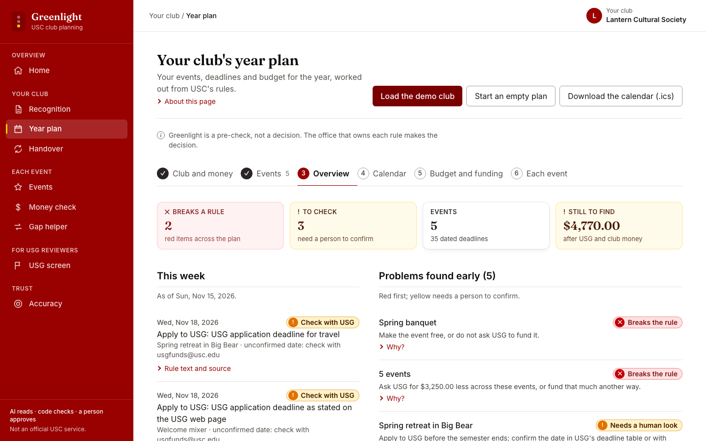
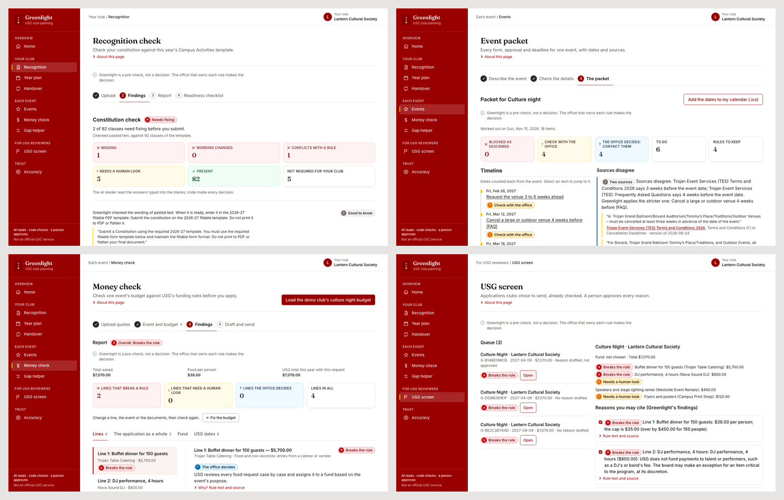
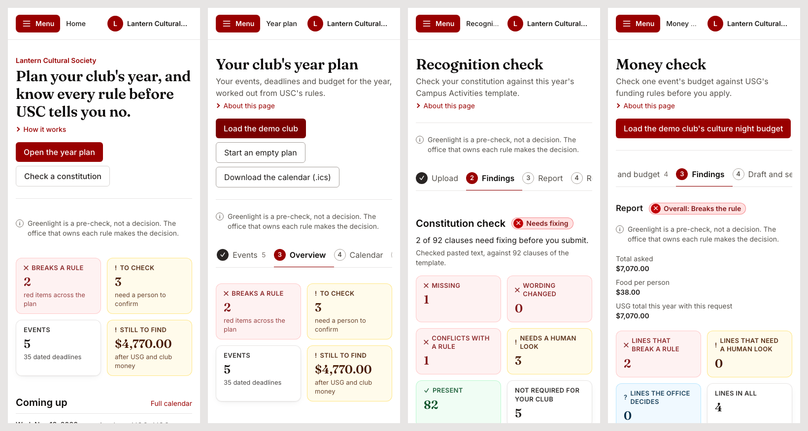
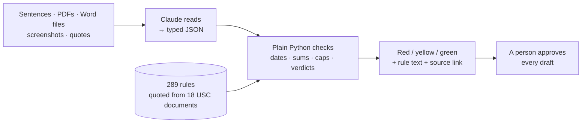
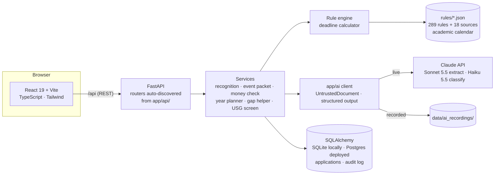

# 🚦 Greenlight

<div align="center">

**Plan your club's whole year, and know every form, deadline and rule before USC tells you no.**

**AI reads the messy input, plain code checks it against 289 sourced rules, and a person approves every draft.**

[](https://github.com/Advait0801/greenlight/actions/workflows/ci.yml)


[](https://www.python.org)
[](https://fastapi.tiangolo.com)
[](https://docs.pydantic.dev)
[](https://www.sqlalchemy.org)
[](https://react.dev)
[](https://www.typescriptlang.org)
[](https://vite.dev)
[](https://tailwindcss.com)
[](https://www.anthropic.com)
[](https://greenlight--manasman1.replit.app)

**[▶ Open the live app](https://greenlight--manasman1.replit.app)**: no sign-up, no setup. Start with **Load the demo club** on the year plan, then follow the [3-minute walkthrough](#-try-the-demo-3-minutes).

*Built at the AI@USC hackathon (HackSC × USC AI Committee), November 14–15, 2026.*

</div>

---

## ✨ At a glance

| | |
|---|---|
| 📅 **Year plan** | A whole year of events and money becomes one calendar, a budget, a funding plan within the caps of the Undergraduate Student Government (USG), and the problems to fix early, with the deadlines on one timeline |
| 📜 **Recognition check** | A club constitution checked **clause by clause against all 92 clauses** of the required template; missing, changed, conflicting or fine |
| 🎟️ **Event packet** | One sentence about an event becomes every form, approval and deadline, sourced, dated where a rule gives a countable period, and marked where **official sources disagree** |
| 💵 **Money check** | Each budget line marked red, yellow or green against USG's funding rules, with the fix and a draft application |
| 🛡️ **Built against wrong greens** | **0 missed and 0 wrongly flagged** across four hand-written test sets (740 planted faults and checks). Unsure means yellow, judgment calls say "the office decides" |
| 🔗 **Every finding is sourced** | 289 rules quoting **18 USC documents**; the 284 verified ones are checked word for word against saved copies on every push to main, the other 5 are shown yellow |

---

## 🎬 Demo

<div align="center">

**The year plan: five events and $1,200 on hand become a calendar, a budget and the problems to fix early**



**Recognition, event packet, money check and the USG screen**



<details>
<summary><b>And on a phone</b></summary>
<br>

</details>

</div>

---

## 📱 Overview

Running a USC club means passing checks owned by different offices: yearly **recognition**, **event approvals** and **Undergraduate Student Government (USG) funding**. Each has its own rules and clocks, no single page puts them on one timeline, and a small mistake can cost a club its funding or its recognition. One club was denied recognition over three missing words in its constitution ([Daily Trojan](https://dailytrojan.com/2024/10/01/clubs-persist-despite-setbacks/)).

**Greenlight** is a planning and pre-check tool for the officers who deal with this. An officer enters the year's events and money once. Greenlight returns a year plan and, for each event, the forms, deadlines and funding checks, each linked to the official rule behind it. It also gives USG's reviewers a screen where applications arrive already checked.

Greenlight is a **pre-check**: it never submits anything and never makes a decision. The office that owns each rule makes the decision.

---

## 🧠 The one principle: AI reads, code checks, a human approves



- **The model only reads and drafts.** It turns sentences, PDFs and screenshots into typed JSON and writes drafts. Nothing else.
- **Every number, date, sum, cap and verdict comes from plain Python**, using a rule table a person has reviewed. No arithmetic or date maths in a prompt. No figure the model calculated is ever shown; figures it read are shown to you to confirm.
- **Every finding carries the rule text and its source link.** Where official sources disagree, both are shown and the stricter one applies.
- **Unsure means yellow.** When the model is unsure, the item is marked for a human look. It never guesses green.
- **Judgment calls say "the office decides"**, never a pass.
- **Uploaded text is data.** Files go to the model wrapped as untrusted data, and the model is told not to follow anything inside them. An obeyed instruction can't change a date or a sum, because code makes those. It can mislabel what was read, which can turn one line green; the officer sees the reading and can correct it ([known issues](docs/reviews/known-issues.md)).

---

## 📏 Measured, not asserted

`python scripts/run_eval.py` runs the real checks on four hand-written test sets with known answers ([`data/eval/`](data/eval/)). The app's **Accuracy** page shows the same figures, and a test keeps them equal to a fresh run.

| Test set | Cases | Caught | Missed | Wrongly flagged | What's checked |
|---|---|---|---|---|---|
| **Events** | 30 | 456 | **0** | **0** | 30/30 obligation lists match end to end through the AI reading step; 30/30 conflict lists match on the engine; 1 status difference, on the safe side |
| **Budgets** | 20 | 30 | **0** | **0** | 30/30 seeded violations caught, totals exact 20/20, fund right or yellow 20/20 |
| **Constitutions** | 10 | 21 | **0** | **0** | 21/21 planted faults found, including blanks, changed wording and conflicting clauses; 1 found with a different red state than the key |
| **Year plans** | 2 | 233 | **0** | **0** | Calendars, budget totals and all 12 problems match; every split adds up |

"Missed" counts **wrong greens**: a planted fault shown as fine. It is the number Greenlight is built to keep at zero.

### The rule table

| | |
|---|---|
| **289 rules** | events 71 · funding 76 · outside money 22 · recognition 120 |
| **18 sources** | 17 fetched by script and snapshotted with fetch time and SHA-256 in [`rules/sources/`](rules/sources/), raw files committed so each snapshot can be re-derived offline; 1 (USG's deadline table, behind a USC sign-in) is a hand transcription and its rules stay yellow |
| **284 verified** | Each rule's quoted text matches its snapshot exactly (`scripts/validate_rules.py`, run in CI) |
| **5 unverified** | Shown yellow with what to confirm and whom to ask, never as certain; 15 rules that depend on them are yellow too |

---

## 🛡️ Built to be trusted

- **One door to the model.** `backend/app/ai/` is the only code that talks to Claude, and an architecture test fails if any module outside a short allow-list of reading and drafting services imports it. Untrusted text goes in an `UntrustedDocument`; instructions are written by code.
- **A green has to be earned.** A `Finding` refuses to be green unless its citation matches the rule table, the rule is verified, and the rule is not one the office decides.
- **Runs without an API key.** Recorded mode (`AI_MODE=recorded`, the default) replays saved readings, so every test and the demo's reading steps run offline. Two drafting steps have little or no recording: the application draft falls back to the code-built draft without its written paragraphs, and a USG denial reason is drafted only for the recorded selection of findings.
- **Nothing is submitted or sent.** No submission, no email, no connection to EngageSC (USC's club portal) or any USC system. Every draft waits for a person to approve it. In live mode, uploaded text is sent to Claude to be read, and what was read is kept in an audit log.
- **AI readings are audited.** What the model read is written to an audit log.
- **Reviewed by adversaries.** Every phase went through fresh reviewer agents (verify, break, audit), then three final reviews for correctness, security and the product: **35 reports from reviewer agents** on the code in [`docs/reviews/`](docs/reviews/). Breakers left **201 adversarial tests**; known issues at submission are listed in [`known-issues.md`](docs/reviews/known-issues.md).

---

## 🧩 Features

### 📅 Year plan
- Enter the club, its money on hand and the year's events, or load the demo club
- **Paste a list** of events, one per line: the AI reads it into rows you confirm before anything is checked
- **Calendar** of every deadline across the year, downloadable as `.ics`
- **Budget and funding**: what USG can fund within its yearly and per-event caps, what the club covers, and what is still to find
- **Problems found early**, red first: a ticketed event USG won't fund, the yearly cap used up, a travel deadline that falls before the semester
- **This week**: what is due now
- USG application dates taken from an unconfirmed copy of USG's deadline table, shown yellow with whom to ask

### 📜 Recognition check
- Upload a PDF, Word or text file, a photo or screenshot (transcribed by the AI), or paste the text
- Every one of the template's **92 clauses** marked present, missing, wording changed, in conflict with a rule, needs a human look, or not required for your club
- Catches unfilled blanks (`[insert name]`, "N/A", the template's own words repeated) and clauses that break a rule, such as a GPA limit on membership
- Notes when the file is last year's template, is not the fillable form, or has damaged pages
- A **readiness checklist** for the application: officers, trainings, advisor and documents, with key dates

### 🎟️ Event packet
- Describe an event in a sentence, check the details the AI read, and get the packet
- Every form, approval and deadline, **counted back from the event date**; a deadline the sources don't let code date (USG's academic-week deadlines) is shown yellow with whom to ask
- A timeline, a "sources disagree" panel, items the office decides, and the rules to keep on the day
- Add the dates to your calendar (`.ics`)

### 💵 Money check
- Upload vendor quotes (PDF or image), read by the AI into budget lines, or enter the budget by hand
- The fund the event belongs to, read from its description and confirmed by you
- Each line checked against USG's funding rules: food per person, performer fees, ticket sales, vendor list, deadlines
- The application as a whole, the fund it belongs to and its USG dates
- **Draft the application** once nothing breaks a rule; send the checked application to the USG screen at any point

### 🔧 Funding gap helper
- Ways to cover a shortfall that USC actually allows, and why cash sponsors and raffles are not among them
- Drafts an outreach email for a sponsor; you edit and approve it, and nothing is sent

### 🏛️ USG screen (for reviewers)
- A passcode-protected queue of applications clubs chose to send, **already checked**
- Tick the findings to cite and draft a reason; a person approves it before the club can read it
- A chart of the most common reasons applications fail
- Clubs check the status of a sent application with its reference and token, and can withdraw it

### 🔁 Handover packet
- One editable packet per officer role: what ran, what it cost and what was denied
- A starting plan for next year, built by code from the club's saved history

### 📊 Accuracy
- Caught, missed and wrongly flagged on every test set, straight from the evaluation

---

## 🏗️ Architecture

> **Claude reads, Python decides.** The FastAPI backend holds the rule engine, the deadline calculator and the year planner; the model is called through one client and only ever returns typed JSON.



### 🔄 Data flow

1. **Read**: a sentence, file or quote goes to the AI client inside an `UntrustedDocument`; Claude returns typed JSON, or the recorded answer is replayed.
2. **Confirm**: the officer sees what was read and can correct it.
3. **Check**: the rule engine applies the rules for that event, budget or constitution; the deadline calculator counts dates back from the event on USC's academic calendar.
4. **Report**: each finding is red, yellow, green or "the office decides", with the rule text, its source link and the date the rule was checked.
5. **Approve**: drafts (applications, emails, denial reasons) wait for a person. Nothing is sent.

---

## 🛠️ Tech Stack

### Backend

| | |
|---|---|
| **Framework** | Python 3.12, FastAPI, Uvicorn |
| **Models** | Pydantic v2 (verdicts, citations and findings in `app/schemas/common.py`) |
| **Database** | SQLAlchemy: SQLite locally, Postgres when deployed |
| **Documents** | pypdf (including the encrypted fillable template), python-docx |
| **AI** | Anthropic SDK with structured output; `claude-sonnet-5-5` for extraction and drafting, `claude-haiku-5-5` for classification, set by `MODEL_EXTRACT` / `MODEL_CLASSIFY` |

### Frontend

| | |
|---|---|
| **Framework** | React 19, Vite 7, TypeScript 5.9 (`strict`) |
| **Styling** | Tailwind CSS 4 |
| **Shared UI** | `StatusBadge` (state is never shown by colour alone), `SourceLink`, step navigation |

### Rules, evaluation and CI

| | |
|---|---|
| **Rules** | JSON in `rules/`; a rule without `source_url`, `source_text`, `effective_date` and `verified` does not load |
| **Evaluation** | Plug-in evaluators in `scripts/evaluators/<set>.py`, found by `scripts/run_eval.py` |
| **CI** | GitHub Actions: rule table vs snapshots, test sets vs schemas, `pytest`, adversarial tests, frontend build |
| **Hosting** | Replit, one process serving the built frontend and the API |

---

## 🚀 Getting Started

### Prerequisites

- **Python 3.12** and **Node 20.19** or later
- A Claude API key, **only** for live AI reading. Without one, the app and the tests run on recorded responses (`AI_MODE=recorded`, the default)

### Setup

```bash
cp .env.example .env    # then add your API key if you have one, and set AI_MODE=live
```

Backend, in a virtual environment:

```bash
cd backend && python3.12 -m venv .venv && source .venv/bin/activate && pip install -r requirements.txt
```

```bash
python -m app
```

Frontend, in a second terminal:

```bash
cd frontend && npm install && npm run dev
```

Open http://localhost:5173. The **System status** link at the foot of the page shows whether the rule table and calendar loaded.

The **Load the demo club** button works without any setup. To also write the demo club into the database (the deploy start script does this), run from the repository root, virtual environment active:

```bash
python scripts/seed_demo.py
```

### Ports

| Service | URL | Variable |
|---|---|---|
| Web app | http://localhost:5173 | `FRONTEND_PORT` |
| Backend API | http://127.0.0.1:8000 | `BACKEND_PORT` |

The frontend calls `/api/...` and the dev server forwards it to the backend, so no CORS setup is needed. To run a second copy at the same time, set `BACKEND_PORT` and `FRONTEND_PORT` (for example `8001` and `5174`) in `.env` or in both terminals. See [CLAUDE.md](CLAUDE.md#ports-and-addresses).

### Tests and checks

From `backend/`, virtual environment active. `pytest` runs all 827 tests; the second command runs only the 201 adversarial tests the review agents added:

```bash
pytest
```

```bash
pytest tests/adversarial
```

From the repository root, same virtual environment:

```bash
python scripts/validate_rules.py   # every rule has its fields and matches its snapshot
```

```bash
python scripts/run_eval.py         # accuracy on the four test sets
```

Refresh the Accuracy page's figures after a change:

```bash
python scripts/run_eval.py --json > data/eval/results.json
```

Build the frontend the way CI does (from `frontend/`):

```bash
npm run build
```

---

## 🎯 Try the demo (3 minutes)

Everything below uses made-up data, and its AI readings are recorded, so the reading steps work even when the AI service is slow or down.

1. **Recognition** → *No file to hand? Try a sample constitution* → *Check my constitution* (the *Findings* step opens). A GPA limit on members is flagged as breaking the open-membership rule, and the blank officer-transition clause as missing.
2. **Year plan** → *Load the demo club* (also on **Home**, which then shows the club's dashboard). Five spring events and $1,200 on hand become a calendar and a budget, with the problems to fix early (USG's yearly cap, a ticketed event, a travel deadline that falls before the semester). Step through *Overview*, *Calendar*, *Budget and funding* and *Each event*.
3. In *Each event*, pick *Culture night* → **Open event packet** → *Build the packet*: every form and deadline, sourced and dated where a rule gives a countable period, a "sources disagree" note and items the office decides.
4. **Money check** → *Load the demo club's culture night budget* → *Check the budget* (the *Findings* step opens): catering over the $35 per person cap, a DJ fee and ticket sales are red. To show the USG screen with something to cite, send this red budget now from the *Draft and send* step with the club name `Lantern Cultural Society`. Then go back to *Event and budget* and fix it by hand (there is no one-click fix): on line 1 set Unit price to 35 and Amount to 5250, remove line 2 (the DJ), set *Sells tickets or charges entry?* to No, and check again. The red items clear, items USG judges case by case stay "the office decides" (Greenlight never shows those as a pass), and the application can be drafted.
5. Back on the year plan's *Each event* step, pick *Culture night* → **Close the $1,170.00 gap** → *Show the options USC allows* → the *Draft an outreach email* tab → *Fill in the demo club's example* → *Draft the email*. Edit, then approve; nothing is sent.
6. **USG screen**: reviewers enter the passcode (kept by the team, not public), open the application from the queue and draft a reason from the ticked findings; a person approves it before the club can read it.
7. **Accuracy**: caught, missed and wrongly flagged on the test sets.

---

## ☁️ Deploying

The deployed site is one process: `python -m app --site` (from `backend/`) serves the built frontend and the API under `/api` on one address.

- `scripts/deploy/build.sh` installs the backend into `.venv-deploy/` and builds the frontend
- `scripts/deploy/start.sh` seeds the demo club and starts the site on `$PORT` (default 5000)
- `.replit` runs these two scripts on Replit

Settings come from the environment (Replit secrets), never from the repository:

| Name | Purpose |
|---|---|
| `DATABASE_URL` | Postgres URL (Replit sets it for its database). Without it the site falls back to a SQLite file that a redeploy erases. |
| `AI_MODE` | `live` reads new input with Claude and replays recorded answers for the demo's inputs; `recorded` never calls the API. |
| `ANTHROPIC_API_KEY` | Needed only for `live`. |
| `MODEL_EXTRACT`, `MODEL_CLASSIFY` | Model names. |
| `USG_REVIEWER_KEY` | Passcode for the USG screen, at least 12 characters. Unset: the USG screen stays closed. |
| `APP_ENV` | `production` when deployed. |

---

## 🤖 How it was built

Greenlight was built in about 24 hours with AI coding agents, in eight phases ([`PLAN.md`](PLAN.md)):

| Phase | What |
|---|---|
| 0 | Foundation: rule table, source snapshots, deadline calculator, AI client |
| 1 | Recognition check |
| 2 | Event packet |
| 3 | Money check |
| 4 | Year plan |
| 5 | Gap helper, handover packet and the USG screen |
| 6 | Ship: one-process site on Replit |
| 7 | Three final reviews, then code freeze |

Each feature phase (1–6) ran **three review iterations**, each with one fresh reviewer agent that had not seen the build: a **verifier** against the exit criteria, a **breaker** writing adversarial tests, and an **auditor**. Phase 0 ran four iterations, with one auditor per rule file in the last two, and Phase 7 ran three final reviews (correctness, security, the whole product). Every backend blocker and high finding was fixed with a regression test that fails before the fix. Open findings are in [`docs/PROGRESS.md`](docs/PROGRESS.md), and those from the final reviews in [`known-issues.md`](docs/reviews/known-issues.md).

---

## 📂 Repository Layout

```
greenlight/
├── backend/
│   ├── app/api/           # one router per feature, included automatically
│   ├── app/services/      # rule engine, deadlines, recognition, money check, year planner, gap helper, USG screen…
│   ├── app/rules/         # rule loading, citations, snapshots and the academic calendar
│   ├── app/ai/            # the only code that talks to Claude
│   ├── app/schemas/       # verdicts, citations and findings
│   └── tests/             # unit/, integration/, adversarial/ (written by breaker agents)
├── frontend/src/          # pages and shared components
├── rules/                 # rule files (JSON) and sources/ snapshots of the official documents
├── data/eval/             # four test sets with known answers, and results.json
├── data/ai_recordings/    # recorded AI answers for tests and the demo
├── data/demo/             # the demo club
├── scripts/               # validate_rules, run_eval, seed_demo, fetch_sources, evaluators/, deploy/
└── docs/                  # progress log, review reports, research notes, submission material
```

---

## 📚 Documentation

| Doc | What it covers |
|---|---|
| [`PROJECT_CONTEXT.md`](PROJECT_CONTEXT.md) | The full product brief and the rules it encodes |
| [`PLAN.md`](PLAN.md) | Build phases, review iterations and exit criteria |
| [`docs/PROGRESS.md`](docs/PROGRESS.md) | Where the work stands, phase by phase, with open findings |
| [`docs/reviews/`](docs/reviews/) | Every verify, break and audit report, the final reviews and the known issues |
| [`rules/README.md`](rules/README.md) | The rule format and how sources are snapshotted |
| [`data/eval/README.md`](data/eval/README.md) | The test sets and how they are scored |
| [`CLAUDE.md`](CLAUDE.md) | Instructions for AI coding agents |

---

## ⚠️ Limits

- Greenlight gives information from public USC documents. **It is not an official USC service and its results are not decisions.**
- Rules change. Each rule shows the date it was last checked.
- It does not connect to EngageSC or any USC system.

---

## 🙏 Acknowledgments

- **USC Campus Activities**, the **USG Funding Department** and **Trojan Event Services**, whose public pages and guidelines are the rules Greenlight encodes
- **HackSC** and the **USC AI Committee**, for the AI@USC hackathon
- [**Anthropic**](https://www.anthropic.com), for the Claude API
- [**FastAPI**](https://fastapi.tiangolo.com), [**React**](https://react.dev), [**Vite**](https://vite.dev), [**Tailwind CSS**](https://tailwindcss.com), [**pypdf**](https://pypdf.readthedocs.io) and [**python-docx**](https://python-docx.readthedocs.io)

---

## 📄 Licence

MIT. See [LICENSE](LICENSE).

<div align="center">

**Built in about 24 hours at AI@USC with Python, FastAPI, React and Claude**

⭐ Star this repo if you find it helpful!

</div>
